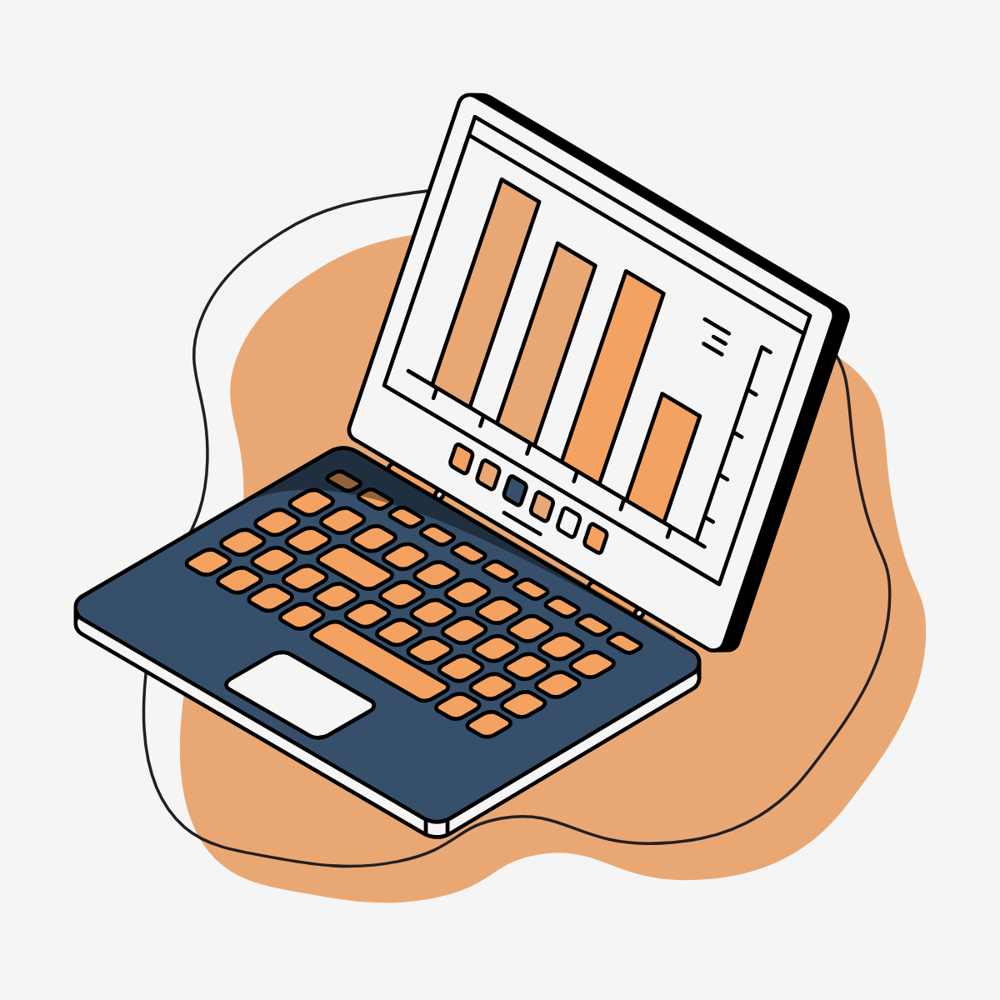

<h3>Olá! Como vai? Meu nome é Nágela, muito prazer!</h3>

Sou estudante na UNIVESP, em transição de carreira para a área de Ciência de Dados e apaixonada por tecnologia e aprendizado contínuo. Minha trajetória profissional no setor público me capacitou em processos de coleta, organização e validação de dados primários em larga escala. Hoje, transfiro essa expertise em qualidade de informação para a área de Ciência de Dados.

Estou sempre em evolução, buscando transformar curiosidade em projetos reais e conhecimento em prática.

---

## 🛠️ Hard Skills em Destaque

---

## 🎯 Portfólio em Destaque

Cada repositório documenta a evolução dos meus estudos, transformando teoria em código prático e documentação clara:

* **[mineracao_de_dados](https://github.com/SEU-USUARIO/mineracao_de_dados):** classificação, agrupamento (clustering) e regras de associação para transformar dados brutos em conhecimento útil.

* **[governanca-ti-memoria-institucional](https://github.com/SEU-USUARIO/governanca-ti-memoria-institucional):** estudo de caso com dados públicos sobre como a centralização do conhecimento ajuda na continuidade dos processos no setor público (Python para análise, classificação e visualização).

* **[Agente-IA-WomakerCode](https://github.com/SEU-USUARIO/Agente-IA-WomakerCode):** agente de IA (padrão ReAct) que filtra notícias do ecossistema de Dados, conecta tendências a fundamentos técnicos e gera relatórios em PDF.

* **[diario-de-inspiracoes](https://github.com/SEU-USUARIO/diario-de-inspiracoes):** agente de IA no Microsoft Azure Cloud, com Engenharia de Prompt e integração por e-mail.

* **[Alura-7DaysOfCode-Python_Pandas](https://github.com/SEU-USUARIO/Alura-7DaysOfCode-Python_Pandas):** análise exploratória com Pandas, integrando CSV, Parquet e JSON, com tratamento de inconsistências e visualização (Matplotlib/Seaborn).

* **[SQL-exercicios](https://github.com/SEU-USUARIO/SQL-exercicios):** prática de SQL com um banco de dados fictício modelado.

---

## ✨ Paixões além do Código

* 🎸 Sou movida a música e completamente viciada em Metal, Rock e na música ruim dos anos 1980 😂

* 🎨 Adoro desenhar, embora seja um hobby que eu sempre prometo praticar com mais frequência.

* 🧝 Sou apaixonada por fantasia medieval, e a música do Condado sempre me arranca uma(s) lágrima(s).

---

## 📧 Conecte-se comigo!

Vamos conversar? Estou sempre aberta a conexões e oportunidades!

* [LinkedIn](https://www.linkedin.com/in/nagelamartins/)
* [E-mail](mailto:nagela.msouza@gmail.com)

*Obrigada pela visita! 💛*
